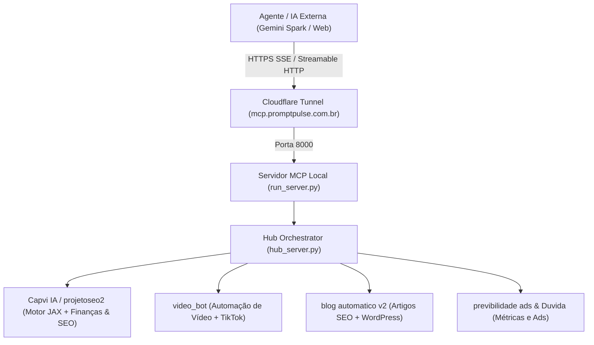

# 🌐 Antigravity Central Hub (MCP Orchestrator)

O **Antigravity Central Hub** é o orquestrador central de automação e inteligência artificial do ecossistema. Ele expõe um servidor **MCP (Model Context Protocol)** que conecta modelos de linguagem (Gemini, Claude, GPT ou agentes do Antigravity) diretamente às ferramentas de execução física no seu computador.

---

## 🏗️ Arquitetura do Sistema



1. **Servidor MCP Python (`run_server.py` + `hub_server.py`):**
   * Roda localmente em `http://127.0.0.1:8000/mcp`.
   * Usa a especificação oficial MCP 2.x com protocolo `streamable-http`.
   * Possui proteções de transporte ajustadas para permitir requisições seguras via proxy.

2. **Túnel Seguro Cloudflare (`cloudflared.exe`):**
   * Cria um túnel com domínio permanente oficial:
     👉 **`https://mcp.promptpulse.com.br/mcp`**
   * Permite que agentes web em qualquer lugar (celular, navegador ou nuvem) acionem ferramentas no seu computador sem abrir portas no roteador ou expor IP público.

---

## 📦 Projetos Integrados e Capacidades

### 1. 🧠💎 `projetoseo2` (Capvi IA) — Acelerador de Lucratividade & Inteligência Regenerativa
Plataforma que une **Kotler**, **V4 Company (AERM)** e **Growth Hacking** com motor matemático vetorial em **Google JAX** (@jit) e cérebro IA Gemini:
* **Simulação Financeira DRE Pro:** Cálculo automatizado de Margem de Contribuição, COGS, Impostos, Frete, Comissão de Marketplace, EBITDA e Ponto de Equilíbrio (Breakeven).
* **Motor SEO & IPM (Índice de Potencial de Mercado):** Análise vetorial de palavras-chave classificando em *Oceano Azul* (IPM > 10.000), *Zona de Crescimento* e *Mercado Maduro*, com detecção de intenção transacional/informacional.
* **Growth Hacking (ICE Score):** Priorização ágil de hipóteses (Impacto x Confiança x Facilidade) com plano de ação (Executar ou Validar MVP).
* **Retenção & CRM (RFM):** Classificação de clientes em Campeões, Leais ou Em Risco com cálculo padronizado Z-score.
* **Refinaria de Benchmarks:** Calibração real de dados de e-commerce (Ticket Médio de R$ 120,65).
* **Stack:** Frontend React + Vite + Tailwind (porta 5173) e Backend FastAPI + JAX (porta 8000).

### 2. 🎬 `video_bot` — Fábrica de Vídeos Verticais (Shorts / TikTok / Reels)
Pipeline automatizado para geração de vídeos curtos em lote:
* **Geração Conceitual & Roteiro:** Criação de ideias poéticas e reflexivas com Claude 3.5 Haiku.
* **Mídia Visual:** Download de takes de alta resolução no Pexels.
* **Legendas & Efeitos:** Tipografia dinâmica, sobreposições e áudio.
* **Renderização:** Renderização em 9:16 acelerada via FFmpeg com color grading.
* **Publicação TikTok:** Integração direta com o perfil **@som_do_infinito** para postar como **Rascunho (BY_DRAFT)** ou publicação direta.

### 3. 📝 `blog automatico v2` — Fábrica de Conteúdo & SEO
* **Geração de Artigos:** Criação automática de posts em Markdown orientados a palavras-chave.
* **Leitura e Listagem:** Consulta aos posts gerados e arquivos de conteúdo.
* **Integração WordPress:** Automação de upload e publicação com formatação SEO.

### 4. 📊 `previbilidade ads` & `Duvida` — Inteligência de Negócio e Anúncios
* Acompanhamento de DRE projetado, ponto de equilíbrio e estratégias analíticas de aquisição de tráfego.

---

## 🛠️ Catálogo de Ferramentas Expostas (MCP Tools)

As seguintes ferramentas ficam disponíveis para a IA chamar autonomamente:

| Categoria | Ferramenta | Descrição |
| :--- | :--- | :--- |
| **Geral** | `hub_status_projetos` | Exibe o status geral de todos os projetos conectados (Capvi SEO, Vídeos, Blog, Ads). |
| **Capvi IA** | `capvi_visao_geral` | Retorna a arquitetura, status de frontend, backend, motores JAX e benchmarks do Capvi SEO. |
| **Capvi IA** | `capvi_simular_dre_financeiro` | Simula o DRE Pro completo com margem de contribuição, EBITDA, breakeven e custos. |
| **Capvi IA** | `capvi_analisar_palavra_chave_seo` | Calcula o IPM (Índice de Potencial de Mercado) e classifica viabilidade (Oceano Azul / Maduro). |
| **Capvi IA** | `capvi_calcular_ice_growth` | Calcula o ICE Score de Growth Hacking (1-10) com prioridade e ação recomendada. |
| **Capvi IA** | `capvi_obter_benchmarks` | Retorna os benchmarks reais calibrados (Ticket Médio R$ 120,65, RFM e taxas de mercado). |
| **Blog** | `blog_listar_posts` | Lista os últimos artigos gerados em Markdown com data e tamanho. |
| **Blog** | `blog_ler_post` | Lê o texto completo de um post específico. |
| **Blog** | `blog_disparar_geracao` | Executa o gerador de artigos via linha de comando para uma palavra-chave/tema. |
| **Vídeo** | `video_listar_videos_gerados` | Lista os arquivos `.mp4` mais recentes na pasta de saída. |
| **Vídeo** | `video_ler_roteiro_atual` | Inspeciona o `roteiro.json` atual com falas e takes. |
| **Vídeo** | `video_gerar_video_com_tema` | Inicia a renderização em segundo plano de um vídeo a partir de um tema. |
| **Vídeo** | `video_criar_e_enviar_rascunho_tiktok` | Pipeline completo: gera o vídeo do zero e o envia diretamente aos Rascunhos do TikTok. |
| **Vídeo** | `video_status_renderizacao` | Acompanha em tempo real os logs de progresso da renderização. |
| **Vídeo** | `video_executar_script` | Executa scripts utilitários pontuais dentro de `video_bot`. |
| **TikTok** | `tiktok_status_conexao` | Checa a validade do token OAuth e escopo da conta TikTok. |
| **TikTok** | `tiktok_publicar_video` | Envia um vídeo específico já existente no disco para o TikTok. |
| **TikTok** | `tiktok_obter_metricas` | Coleta visualizações, curtidas, comentários e compartilhamentos. |
| **Meta Ads** | `meta_ads_status_conexao` | Checa a validade do token Meta Marketing API e status da conta de anúncios. |
| **Meta Ads** | `meta_ads_obter_metricas` | Traz investimento, cliques, conversões, ROAS e campanhas da Meta API (com fallback de contingência). |
| **Meta Ads** | `meta_ads_diagnostico_otimizacao` | Diagnóstico de Media Buyer: avalia CTR, CPC, saturação de público e indica campanhas para escalar ou pausar. |
| **Meta Ads** | `meta_ads_gerar_sugestoes_criativos` | Gera ideias de criativos, ganchos visuais de 3s, copys AIDA e sugestões de vídeos para anúncios. |
| **Meta Ads** | `meta_ads_analisar_lucratividade` | Pipeline integrado: une campanhas Meta Ads ao motor JAX calculando DRE Pro, EBITDA e Breakeven. |

---

## 🚀 Como Iniciar

### Modo Rápido (Recomendado):
Basta clicar duas vezes em:
```bat
central_mcp\iniciar_hub.bat
```
Ou no terminal PowerShell:
```powershell
cd central_mcp
.\iniciar_hub.bat
```

O script automaticamente:
1. Verifica se o `cloudflared.exe` está ativo e inicia o túnel usando a credencial em `token.txt`.
2. Ativa o ambiente virtual Python (`.venv`).
3. Inicia o servidor HTTP MCP na porta `8000`.

---

## 🔗 Endpoints de Conexão

* **Local:** `http://127.0.0.1:8000/mcp`
* **Público Permanente (Cloudflare):** `https://mcp.promptpulse.com.br/mcp`

---

## 📁 Estrutura de Arquivos da Pasta

```
central_mcp/
├── .venv/               # Ambiente virtual com as dependências instaladas (mcp, uvicorn, etc.)
├── cloudflared.exe      # Binário executável do cliente Cloudflare Tunnel
├── hub_server.py        # Definição das ferramentas e orquestração do ecossistema
├── iniciar_hub.bat      # Script batch de um clique para subir túnel e servidor
├── README.md            # Documentação técnica e guia do orquestrador
├── run_server.py        # Inicializador do servidor MCP com configurações de segurança
├── run_tunnel.py        # Script auxiliar de monitoramento do túnel
├── spark_link.txt       # Registro do link de conexão para o Gemini Spark
└── token.txt            # Token de autenticação do túnel permanente Cloudflare
```
